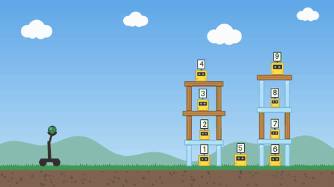
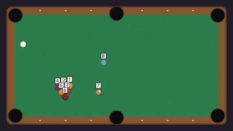
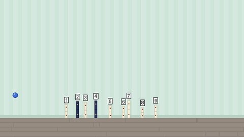

# physics-arcade

[English](README.md) | **简体中文**

**AI 能预测简单物理游戏里接下来会发生什么吗？**
**[排行榜、翻车画廊和人机挑战 →](https://terrybtf.github.io/physics-arcade/)**

physics-arcade 是一组 2D 小型物理游戏构成的基准测试。模型只看一次发射的前 0.4 秒（还没有发生任何碰撞），
就要预测最终结果。所有关卡都由物理模拟器生成，因此关卡数量不受限制、标准答案精确、难度可控。

| 投石机 Catapult | 台球 Pool | 多米诺 Dominoes |
|---|---|---|
|  |  |  |
| 炮弹射向木头、石头、冰搭成的塔。**哪些机器人能幸存？** | 母球刚被击出。**哪些球会进袋？** | 一个小球扔向一排多米诺骨牌。**哪些骨牌会倒？** |
| 倒塌、翻倒、撞击伤害 | 直线几何、翻袋和组合球 | 连锁反应、间距、轻重、台阶 |

## 排行榜（结局预测赛道，v1）

每个游戏 300 局（每档难度 100 局），指标为“确定目标”上的平衡准确率；随机猜测 = 0.50。
每格为 扁平画风 / 卡通画风。

| 模型 | 投石机 | 台球 | 多米诺 |
|---|---|---|---|
| Qwen3-VL-4B-Instruct | 0.631 / 0.591 | 0.702 / 0.573 | 0.500 / 0.497 |
| Qwen3-VL-8B-Instruct (FP8) | 0.508 / 0.537 | 0.698 / 0.644 | **0.398** / 0.513 |
| *非视觉参考†* | | | |
| 弹道路径 / 首撞几何 / 间距规则 | 0.682 | 0.920 | 0.786 |
| 带 1 % / 0.5° 发射误差的模拟器 | 0.993 | 0.697 | 1.000 |
| 全是 / 全否 | 0.500 | 0.500 | 0.500 |

95 % bootstrap 置信区间（按局重采样），扁平 / 卡通：
4B 投石机 [0.60, 0.66] / [0.56, 0.62]，台球 [0.62, 0.77] / [0.50, 0.65]，
多米诺 [0.49, 0.51] / [0.49, 0.50]；
8B 投石机 [0.47, 0.55] / [0.50, 0.58]，台球 [0.63, 0.76] / [0.57, 0.72]，
多米诺 [0.37, 0.43] / [0.49, 0.53]。

† 不看图像，直接读取精确的发射参数和物体位置；各游戏的规则基线忽略了大部分物理（倒塌、库边反弹和组合球、
质量和台阶）。台球的模拟器一行说明台球有多苛刻：0.5° 的瞄准误差就足以改变许多结果。

主要发现：

- **多米诺难倒了两个模型。** Qwen3-VL-4B 在 300 局里有 294 局回答“全部倒下”，得分正好等于随机。
  Qwen3-VL-8B 在扁平画风上甚至低于随机：它认为短而间距均匀的链只会倒第一块（实际上 85 % 都倒了），
  而带间隙、重骨牌和台阶的长链会全倒（实际只有 30 % 倒下）。它的判断跟着链的长度走，而不是间距或质量。
- **台球是视觉模型表现最好的游戏**，在困难桌面上 4B 甚至超过了直线规则（0.76 对 0.69），
  后者在翻袋和组合球上会失败。
- **更大的模型不一定更好：** 在投石机和台球上，8B 并不比 4B 强。
- **提示词措辞影响很大。** 只把答案格式说清楚（任务本身不变），4B 在投石机上就从 0.55 升到 0.63。
  上表所有数字都使用同一份提示词（`physics_arcade.vlm`）。

分难度的成绩：`physics-arcade leaderboard`。所有模型的原始回答（含推理过程）见
[`results/v1/`](results/v1/)。

## 原理

**结局预测赛道（主赛道）。** 对每个带编号的目标（机器人、球、骨牌）预测事件是否发生（幸存、进袋、倒下）。
模型看到的是标注了编号的第一帧，以及发射过程中的 4 帧（只有图像）。

**碰撞是混沌的。** 把发射速度改动 0.25 %、角度改动 0.1° 重放同一局，结果就可能不同，所以单次模拟不是公平的
标准答案。每局都在这种极小扰动下重放 50 次，目标的标签是事件在这些重放中发生的比例。计分方式：

- **确定目标平衡准确率（主指标）：** 只统计命运在 ≥ 90 % 的重放中一致的目标，以多数结果为准。随机为 0.50。
- **Brier 分数：** 覆盖所有目标，奖励校准良好的概率。模型可以对每个目标给出概率。

**难度分档。** 每个游戏都有简单 / 中等 / 困难三档（各 100 局），成绩按档拆分。

| 游戏 | 简单 | 中等 | 困难 |
|---|---|---|---|
| 投石机 | 一座建筑 | 两座建筑 | 铺满场地、高塔 |
| 台球 | 1–2 个球，直接击球 | 3–5 个球，翻袋 | 6–9 个球，球堆、组合球 |
| 多米诺 | 4–6 块相同骨牌 | 6–8 块，高度不一、有重骨牌 | 8–11 块，外加台阶 |

**两种画风**，物理完全相同：`flat`（每类物体一种纯色）和 `cartoon`（有纹理、更像游戏）。两者的分数差能看出
模型的错误有多少来自“看不懂画面”而不是物理。所有美术素材都是程序生成的原创内容。

**视频推演赛道（视频世界模型）。** 把剩下的 5.6 秒生成成视频。生成的帧会按颜色（卡通画风用拟合的颜色表）
切分回物体类别，再与模拟器的真实类别图比较（mean IoU）。

## 快速开始

```bash
uv sync
D=data/catapult_v1
uv run physics-arcade generate --game catapult --out $D --n 100            # 加 --style cartoon 生成卡通画风
uv run physics-arcade baseline --data $D --name ballistic --out preds/ballistic.jsonl
uv run physics-arcade eval-outcome --data $D --pred preds/ballistic.jsonl
uv run physics-arcade leaderboard --data $D "Ballistic=preds/ballistic.jsonl"
uv run physics-arcade predictability --data $D --out analysis/catapult.jsonl   # 每局有多混沌？
uv run physics-arcade baseline --data $D --name oracle --out preds/oracle  # 视频赛道的评分自检
uv run physics-arcade eval-rollout --data $D --pred preds/oracle
uv run physics-arcade visualize --data $D --pred preds/oracle --ep hard_0003 --out viz/hard_0003.mp4
```

数据集结构：`tasks.jsonl` 和 `inputs/<id>/`（开头帧、开头视频、标注编号的第一帧）是模型可以看到的；
`answers/` 存放隐藏的标签和类别图。结局预测的提交格式是 JSON Lines：
`{"id": ..., "ids": [事件发生的目标], "p": {"<id>": 概率}}`（`p` 可选）。

## 评测一个模型

`physics_arcade.vlm` 包含统一的提示词、答案解析和可断点续跑的循环；后端只需把“图像 + 文字”的列表转成回复，
所以接入一个 API 模型只要几行代码。`models/qwen_vl/` 在本地运行 Qwen3-VL（4B 用 bf16、8B 用 FP8，
都能放进 16 GB 显存）：

```bash
cd models/qwen_vl && ./setup.sh
.venv/bin/python run_qwen_vl.py --model Qwen/Qwen3-VL-8B-Instruct-FP8 \
    --data ../../data/catapult_v1 --out ../../preds/qwen3vl_8b_catapult.jsonl
```

`models/cosmos/` 用 NVIDIA Cosmos-Predict2-2B-Video2World 跑视频推演赛道（目前只有投石机的提示词；需要在
Hugging Face 上获得 Cosmos 和安全过滤仓库的访问权限）。`models/cosmos/dry_run.py` 把真实视频送进同样的
16 fps 重采样流程，用来测量这条流程的分数上限。

## 网站

`docs/` 里的网站（GitHub Pages）是纯静态的。`uv run python scripts/build_site.py` 会从卡通数据集和
`results/v1/` 重新生成网站的数据和媒体文件；本地预览用 `python3 -m http.server --directory docs`。

## 添加一个游戏

一个游戏就是一个 `physics_arcade.core.game.Game`：物理、扁平和卡通两种渲染、按难度生成关卡、可接受扰动的
确定性 `replay`，以及题目文字。数据集写入、标签、评分、类别切分、可视化和 VLM 评测框架都是共用的。
现有的三个游戏见 `src/physics_arcade/games/`。
